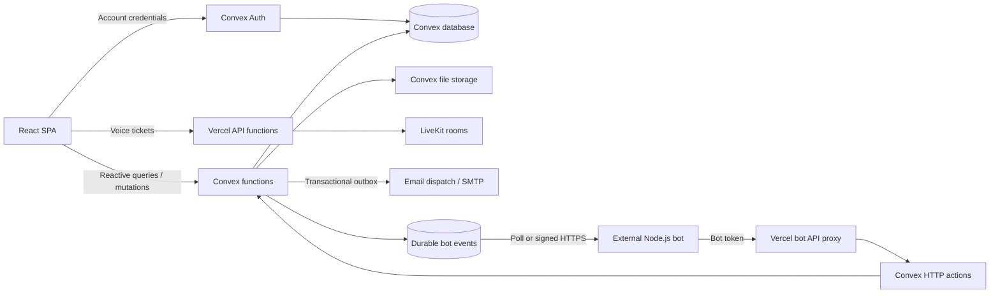

# KyroFree technical architecture

This overview describes the repository as inspected and the integrated bot platform added in this change. KyroFree is a community chat application: a React single-page frontend, a Convex backend and document database, and a small set of Vercel HTTP functions for external services. It does not have a separate Express server, SQL database, or ORM.

## System map



Vercel deploys the frontend and `api/` functions. Convex functions and schema are deployed separately. Git pushes alone do not update the Convex backend.

## Frontend

- **React 19.2**, **TypeScript 5.9**, **Vite 7.3**. `src/main.tsx` creates the React root, Convex client, authentication provider, router, error boundaries, toast provider, and development-only Freebuff toolbar. Vite emits static assets into `dist/`.
- **React Router 7**, with imports from `react-router`. Public routes include the landing page, `/auth`, legal pages and `/invite/:code`. `RequireAuth` protects `/dashboard/*` and preserves the requested return URL. `Dashboard.tsx` mounts the shared `AppShell` and nested routes for friends, direct messages, discovery, server channels, forums, voice, settings, and the administration portal.
- **Tailwind CSS 4** and **shadcn/Radix** supply the design system. Lucide provides icons, Framer Motion animations, Sonner notifications, and Recharts charts. The app has responsive desktop navigation and a separate mobile navigation layout, plus a manifest and production service worker.
- **Convex `useQuery` / `useMutation` / `useAction`** own server state. Queries are reactive subscriptions rather than REST fetches from each screen. **Zustand** persists local preferences, drafts and interface state; it does not replace the database. React Hook Form and Zod support form validation.
- Domain components are under `src/components/app/`; reusable UI primitives are under `src/components/ui/`. `src/lib/` contains permissions, upload handling, markdown, appearance helpers, preferences and integration utilities. `src/hooks/use-auth.ts` is the shared authentication facade.
- Vite aliases `@` to `src`, deduplicates React, and splits vendor/UI chunks. TypeScript uses strict checking, bundler resolution and separate browser/server configurations. The SDK has its own emitting TypeScript configuration.

The bot feature adds `/dashboard/developers/:applicationId?`, `/dashboard/bots/:applicationId?`, and `/dashboard/bots/authorize/:applicationId`. It extends the existing composer, message list, profile cards, navigation and server bot settings.

## Backend architecture

The `convex.json` function directory is `src/convex/`. Modules generally follow product domains: `users`, `servers`, `channels`, `roles`, `messages`, `conversations`, `social`, `moderation`, `automod`, `polls`, `forums`, `threads`, `voice`, `security`, and email modules.

- **Queries** read authenticated data and drive reactive frontend subscriptions.
- **Mutations** make transactional database changes. Throwing from a mutation rolls back its writes. Business authorization is enforced in functions, not delegated to the frontend.
- **Actions** perform work outside a database transaction, such as password-account operations, email/GIF services and Node-dependent webhook delivery. They use internal queries/mutations for persistence.
- **Internal functions** separate trusted service operations from browser-callable functions. `src/convex/_generated/` contains typed API, server and data-model helpers; the repository commits these for offline Vercel builds.
- Shared helpers in `lib.ts` enforce active accounts, server membership, blocks, bans and platform authority. `cleanup.ts` implements explicit deletion cascades. Permissions are string capabilities defined in `src/lib/permissions.ts`, combined from membership roles and per-channel overrides.
- `src/convex/functions.ts` is the stable mutation wrapper for transactional bot event triggers. Application modules import their function builders from this file. Code generation may replace `_generated/server.ts` without removing event delivery. New mutation modules that change observable chat entities must use the stable wrapper.
- Cron jobs retry transactional email, clean expired verification records, notify expired bans, deliver bot webhooks, and expire bot event/interaction records. Other maintenance functions remain separate domain modules.

The Vercel `api/` surface contains email health/dispatch, LiveKit token/moderation, and the bot REST proxy. Supporting Node code is under `server/email`, `server/livekit`, and `server/bots`. Convex remains authoritative for application data and permissions.

## Database and schema

Kyro uses Convex's indexed document database and file storage. The schema is TypeScript in `src/convex/schema.ts`, with bot tables in `botSchema.ts`. The original schema declares 51 application tables, including its custom `users` table; this change adds seven bot tables. Convex Auth also contributes its credential/session tables through `authTables`.

| Domain                          | Tables and relationships                                                                                                                                                                                                      |
| ------------------------------- | ----------------------------------------------------------------------------------------------------------------------------------------------------------------------------------------------------------------------------- |
| Identity and relationships      | `users`; `connections` for friendships; `blocks` for directional blocks. Public user hydration excludes credentials.                                                                                                          |
| Direct/group chat               | `conversations` and `conversationMembers`; channel/DM messages share the polymorphic `messages.containerType/containerId` model.                                                                                              |
| Communities                     | `servers` references an owner; `serverMembers` joins users to servers and carries role IDs, nicknames and timeout state; `serverRoles` holds permissions and hierarchy; `categories` groups `channels`.                       |
| Content                         | `messages` references its author, optional reply and attachments; `reactions`, `reads`, `typing`, `threads`, `threadMessages`, `forumPosts`, `forumComments`.                                                                 |
| Polls and assets                | `polls` belong to messages; `pollVotes` record choices; `uploads` tracks owner and claim target; `serverEmojis`, `emojiPreferences`, `gifFavorites`. Binary content lives in Convex storage.                                  |
| Server onboarding/customization | `invites`, `joinApplications`, `serverTemplates`, and the existing canned-response `serverBotCommands`.                                                                                                                       |
| Moderation                      | `bans`, `moderationCases`, `auditLogs`, `serverAutomod`, `automodEvents`; platform-wide `siteBans`, `adminActions`, `warnings`, `reports`, `bugReports`.                                                                      |
| Notifications/email             | `notifications`, `channelNotificationSettings`, `emailOutbox`, `passwordResetCodes`, `passwordResetRequests`, `emailVerificationCodes`, `emailVerificationRequests`.                                                          |
| Account security                | `accountSecurity`, `passkeyCredentials`, plus Convex Auth tables such as `authAccounts`, `authSessions`, refresh tokens and verification state. Schema presence alone does not imply that a passkey login provider is active. |
| Calls/voice                     | `voiceSessions`, `voiceSignals`, `livekitTickets`, `calls`. Media transport is provided by LiveKit; application authorization and session state stay in Convex.                                                               |
| Bot platform                    | `botApplications`, `botInstallations`, `botCommands`, `botInteractions`, `botEvents`, `botRateLimits`, `botAuditLogs`.                                                                                                        |

Common indexes cover server/user membership, usernames, message containers and timestamps, message client IDs, storage IDs, and per-user settings. The bot schema indexes owners, token digests, application/server installations, command scope/name, event delivery mode/status/due time, and record expiry.

References use typed Convex IDs, but cascades and authorization are application logic rather than SQL foreign keys. **`schemaValidation: false` remains the existing configuration**: schemas provide generated types and indexes, while public argument validators, Zod contracts, and authorization helpers remain essential. This change does not enable global schema enforcement or require rewriting existing records. Existing user, role and message documents gain optional bot metadata/embeds, preserving older records.

## Authentication and authorization

The active login system is **Convex Auth with one custom `password` credentials provider**, implemented in `auth/passwordWithTwoFactor.ts`. Older README claims about anonymous/email-OTP login were stale.

Registration uses `users/createAccount.ts`: validates email/password/username, checks reservations, creates the credential-backed human account, initializes the profile and joins Kyro HQ. Password verification uses **Scrypt** via Lucia. Convex Auth manages session/access/refresh tokens with deployment signing keys and JWKS.

Accounts can enable **TOTP** and hashed one-use recovery codes. The same password provider enforces the second factor, so a separate unguarded password provider cannot bypass it. Email verification is optional through `KYRO_EMAIL_VERIFICATION_ENABLED`; password reset and email delivery have their own durable records and deployment secrets. Founder authority is bound to `KYRO_FOUNDER_USER_ID`, not a mutable username.

The existing auth configuration also accepts Freebuff federated RS256 tokens via its configured issuer/JWKS and `vly-convex` audience. This is separate from Kyro's password credential provider.

Human server access uses membership, roles, channel overrides and moderation restrictions. Bot authentication is separate: an application owns one marked `users` row with **no password/auth-account row**, and a cryptographically random API token whose SHA-256 digest is stored in `botApplications`. A bot token cannot sign in through the human authentication provider. Each request checks the application and its owner's availability, then installation membership and effective permissions. Installation grants cap bot access even if a human assigns it an administrator role.

## APIs and integrations

The application's primary API is typed Convex RPC: frontend imports from `_generated/api` map directly to validated query/mutation/action exports. `src/convex/http.ts` mounts Convex Auth HTTP routes and the new bot routes.

External services include:

- **LiveKit**: browser client, server SDK, ticket-based authorization, room token issuance and moderation through Vercel endpoints.
- **Email**: Convex transactional outbox, retries and signed dispatch to a Node SMTP transport; `nodemailer-secure` aliases the installed Nodemailer package. See `docs/email-notifications.md` for required secrets and providers.
- **GIFs**: KLIPY-backed search and attribution, configured with `KLIPY_API_KEY`.
- **Freebuff/Vly**: development integration and optional monitoring hooks. The toolbar mounts only during development.
- Optional AdSense settings slots and normal external profile links.
- **Bot API**: versioned JSON REST endpoints at `/api/bots/v1`, a durable polling/signed-webhook event stream, and the repository-distributed `kyro.js` SDK. See `docs/bot-platform.md` for the complete contract.

## Existing product features

The repository already includes account registration/sign-in, profiles and presence, friends/blocks, direct and group conversations, server discovery and invitations, join applications, roles and channel overrides, text/voice/forum channels, message editing/deletion/replies/reactions, mentions and notifications, attachments, search, threads, polls, custom emoji, GIFs, server templates, canned slash responses, moderation cases and AutoMod, reports, account warnings/bans, staff tools, transactional email, and LiveKit calls/voice. Appearance features include profile decoration, badges, server tags and community themes.

The added developer platform supplies persistent application management, bot identities and token rotation/revocation, explicit server installation consent, bot role grants, rich REST messaging and moderation helpers, typed global/server slash commands, private interaction replies, event subscriptions, signed webhook retries, discovery/categories, staff verification/suspension, reports, recorded analytics/audits, and an external Node.js SDK. It reuses the existing users, memberships, roles, messages, polls and upload model. The legacy server canned-response feature remains available.

## Dependencies and development

`package.json` is the direct-dependency manifest; `package-lock.json` records the npm resolution. Key groups are React/React DOM/React Router; Convex/Convex Auth/convex-helpers; Tailwind/shadcn/Radix; Zustand; Zod/React Hook Form; Framer Motion; LiveKit client/server; Nodemailer; date-fns; Lucide; Recharts; QR code and rendering utilities. Axios and Hono are also declared. Three.js is not a direct dependency of this checkout.

Tooling includes TypeScript, Vite and its React plugin, ESLint 9 and React Hooks rules, Prettier, tsx, Vitest/convex-test, and Playwright. Node 20.19+ is required by the SDK and the current Vite toolchain; this change was validated using Node 24.18 on Windows.

```sh
npm ci
npm run gen:convex
npm run build:sdk
npm run typecheck
npm run lint
npm run test:bots
npm run test:email
npm run test:voice
npm run build
```

The bot integration and browser scripts intentionally target a disposable local Convex deployment. They create real test accounts and database records and never select a production URL. Build artifacts, local deployment data, secret environment files and browser results are ignored by Git.

Operational boundaries remain explicit: no hosted user-code runtime or generic OAuth authorization server is introduced; the SDK is not npm-published; Convex deployment, SMTP, LiveKit and webhook signing keys require environment configuration. Automated tests and local browser checks do not establish production capacity or prove a cloud rollout.

The dependency audit reports nine advisories in the existing Vly/transitive Zod and ESLint/minimatch dependency paths (two high, seven moderate). The new bot contracts use the root Zod 4 dependency. These inherited dependency findings are not resolved by this feature; replacing the platform integration or forcing toolchain downgrades needs separate review.
